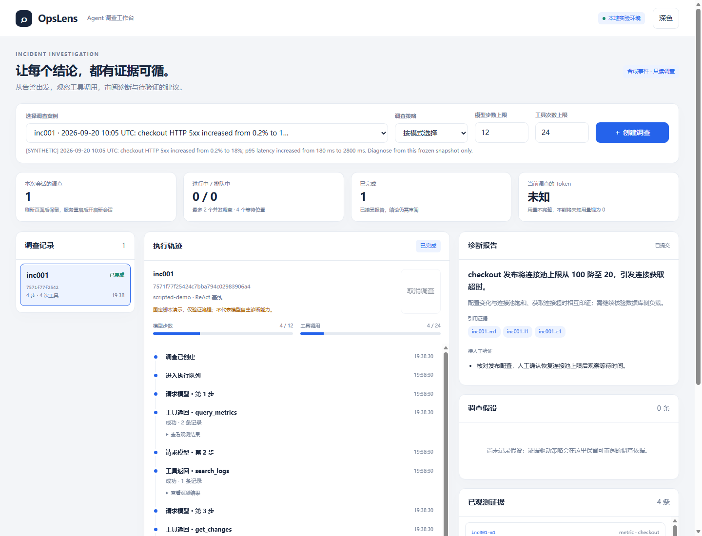
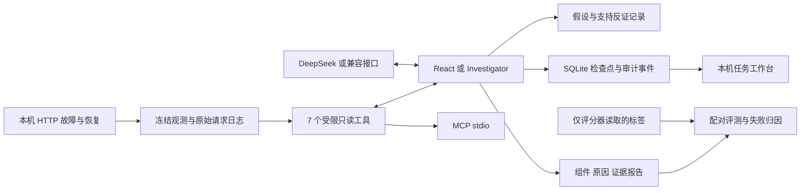

# OpsLens 可验证的故障调查 Agent

OpsLens 把一次故障调查做成可复现的工程实验：采集真实本机服务故障，模型调用只读工具收集证据、检查竞争假设，生成可追溯诊断，再与固定流程和单次模型调用进行配对评测。

它关注三个问题：**Agent 能否找到正确组件和原因？新增调查机制是否比简单基线更有效？失败后能否解释、恢复并复跑？**

当前版本为 0.3.1。已完成 8 个案例、4 种策略、32 次真实 DeepSeek 对照尝试，并保留冻结源码、快照、失败轨迹和用量。**结果未证明 Investigator 普遍优于简单基线；复核还发现数值检查误报、类别口径与证据标注问题。** 后续修复、3 次已知案例回归与原始成绩分开记录；181 项本地软件测试通过，不宣称线上收益或生产就绪。见 [实验结果](docs/EXPERIMENT_RESULTS_V03.md) 和 [全部逐案例产物](eval/results/v03/README.md)。



## 立即运行

Python 3.11+，在仓库根目录执行。核心运行时无第三方依赖。

```powershell
python -m unittest discover -s tests -q
python -m opslens serve
```

打开终端打印的本机网址，默认 [http://127.0.0.1:8765](http://127.0.0.1:8765)。选择 inc001 并开始调查，即可查看任务、增量轨迹、证据与报告。默认是明确标注的**固定脚本演示**，不代表模型自主能力。

无需模型 Key 也可采集真实故障：

```powershell
python -m opslens lab --suite --seeds 17 --output runs/lab
```

这条命令启动两个临时本机 HTTP 服务，实际发出并发请求，运行正常对照、池耗尽、下游超时和错误配置，验证恢复后关闭服务。输出原始请求日志、观测快照、控制面审计和带 SHA-256 的评测清单。将打印的 manifest 路径代入：

```powershell
python -m opslens benchmark --manifest runs/lab/manifest-实际ID.json --dry-run
```

`--dry-run` 核验数据哈希、分组和预算，不调用模型。

## 用 DeepSeek 调查

在仓库根目录的 `.env` 中填写一次 `DEEPSEEK_API_KEY=你的密钥`，保存后执行；后续启动会自动读取，无需重复输入：

```powershell
python -m opslens run --policy investigator --case data/cases/inc001.json
```

可以把 `--case` 换成实验生成的 `snapshot.json`。同名环境变量优先于 `.env`，`.env` 已被 Git 忽略。若不希望保存密钥，可加 `--prompt-key` 在终端临时输入且不回显。不要把密钥发送到聊天或写入源码。

默认模型为 `deepseek-flash`，可用 `OPSLENS_MODEL` 覆盖。首版使用非思考模式和原生 function calling，每次输出上限 4096 token。配置根据 [DeepSeek 模型文档](https://api-docs.deepseek.com/quick_start/pricing/) 与 [调用协议](https://api-docs.deepseek.com/api/create-chat-completion/)核对。其他供应商可用 `--provider compatible` 及 `.env.example` 中的三个兼容接口变量，实际兼容性仍需测试。

真实模型工作台：

```powershell
python -m opslens serve --mode live --port 8766 --cases data/cases/inc001.json data/cases/inc005.json
```

浏览器不接收密钥。服务仅监听回环地址，带任务队列、并发上限、取消、同源检查和增量事件；这是本地开发服务，不宜直接暴露到公网。

## 四种策略如何比较

| 策略 | 决策方式 | 用途 |
| --- | --- | --- |
| single-shot | 全服务固定宽查询，然后一次模型诊断 | 检验动态调查是否有必要 |
| fixed-workflow | 指标与变更固定查询，按告警词检索日志和手册，然后一次诊断 | 比较固定检索流程 |
| react | 模型根据工具结果选择下一步 | 普通 Agent 基线 |
| investigator | 动态查询加结构化故障假设、支持证据和反证记录 | 待实验验证的调查策略 |

所有策略使用相同可访问数据源、累计观测字符和记录预算。检索方式有意不同，不能解释为完全相同上下文下的模型对比。假设门控只约束结构和来源，**不保证语义与因果正确**。

0.3 增加数据能力发现、明确的阶段查询错误、每轮剩余预算提示和有限的数值风险检查。报告被拒绝后可以在原预算内修正，错误仍保留；规则漏检和误报均需单独审阅。评分支持根因组件和可替代证据组，单次评分与批量清单共享标签。

```powershell
python -m opslens benchmark --manifest eval/fixtures.manifest.json --prompt-key --max-model-calls 60
```

这会调用真实模型。预算耗尽的未完成任务仍保留在分母中，并标记实验不完整。四策略全网格最坏调用量大于 60；示例预算用于小规模联调，不是完整实验的推荐预算。

评测保存输入快照、配置、源码哈希、每个尝试、工具轨迹和失败归因。报告按数据来源与划分分别汇总，提供成功率区间、延迟分位数和按故障组聚类的配对 bootstrap 差值。重复运行不被当成独立故障样本，失败不丢弃，也不挑选最好的重试。定义见 [评测协议](docs/EVALUATION.md)。

评分同时检查类别、标签指定的根因服务、关键证据和引用来源。证据 ID 存在不代表其支持结论；解释语义需要独立人工审核。

## 实现结构



| 模块 | 关键实现 |
| --- | --- |
| `lab.py` | 两服务 HTTP 请求、三阶段观测、故障质量门槛、来源审计 |
| `runtime.py` / `investigation.py` | 原生工具循环、竞争假设、报告门控、调用及 token 阈值 |
| `context.py` | 精确证据压缩、原始历史保留 |
| `tools.py` / `retrieval.py` | 指标、日志、变更、手册、证据回取、跨服务 trace；BM25 基线 |
| `store.py` / `providers.py` | 原子检查点、乐观锁、模型错误脱敏、有限重试 |
| `benchmark.py` / `evaluation.py` | 冻结数据、统一预算、对照策略、分组统计、失败归因 |
| `server.py` / `web/` | 本机队列服务、任务取消、轨迹和证据浏览 |
| `mcp.py` | 只读工具的 MCP stdio 接口 |

## 恢复和预算边界

```powershell
python -m opslens demo --stop-after 2
python -m opslens resume <run_id>
```

真实模型恢复加 `--mode live`，提供相同 `--case` 与供应商配置。运行前打印 ID；恢复检查数据、提示词和工具定义指纹。请求前持久化步数，中断请求的未知计费标为不完整。只读工具回合可能在崩溃后重复，不承诺 exactly-once。

`--max-steps`、`--max-tools` 限制回合及工具调用；`--max-tokens` 根据已返回的累计 token 在下一请求前停止，最后一响应可能超过阈值；`--context-chars` 是字符上限而非精确 token 数。它们不是金额硬上限。benchmark 另有全局请求上限，评测中关闭内置 HTTP 重试。

## 边界与后续证据

本机实验只有两服务、一条调用链和四个预设场景；池用信号量模拟客户端并发资源，不是实际数据库连接池。当前数据全部用于开发，同模板换 seed 不能代表未见故障泛化。没有生产流量、独立盲测集或线上收益。

提示注入样例验证工具不会执行日志文本，模型抵抗注入仍需实测。没有自动生产修复。BM25 是词项检索，不是语义检索。MCP 首版是有限的 stdio 工具接口，见 [互操作说明](docs/MCP.md)。

## 阅读与继续开发

- [第一次实践](docs/FIRST_SESSION.md)：运行真实故障，理解证据，再研究策略。
- [技术取舍](docs/DECISIONS.md)：选择、替代方案及代价。
- [实验环境](docs/LAB.md)、[服务接口](docs/SERVICE.md)、[评测协议](docs/EVALUATION.md)。
- [求职交付标准](docs/ROADMAP.md)：已有实现与仍需实测的证据。
- [相关研究](docs/RELATED_WORK.md)：与公开 RCA 基准的区别。

系统针对 Agent 应用工程。源码、框架和测试数量不能替代真实模型结果与个人解释能力；训练、强化学习和底层推理优化岗位还需要额外作品。
